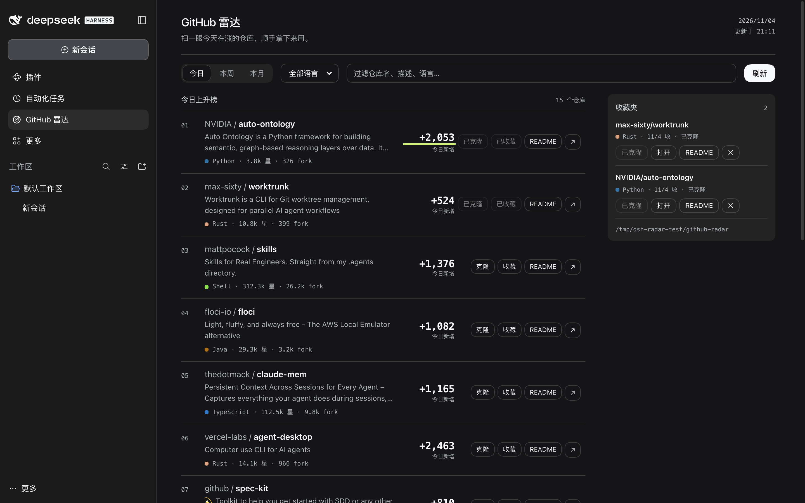

# GitHub 雷达 · dsh-plugin-github-radar

> 在 DSH 里刷 GitHub 趋势：看今天什么在涨，收藏、读 README（一键中文）、标星、把仓库拉下来。




装好后左栏多一个「GitHub 雷达」入口，点开就是趋势榜。它不是独立网页，是 DSH 自己的面板，亮色 / 暗色主题跟着 DSH 走。

## 安装

```bash
git clone https://github.com/1578361862-art/dsh-plugin-github-radar.git
cd dsh-plugin-github-radar
dsh plugin --profile desktop add file:$PWD
```

重启 DSH 即可。

还没发布到 npm。也可以走索引源安装：把仓库里的 `index.json` 放到任意 https 地址，在「插件 → 发现 → 添加索引源」里填 URL。

卸载：

```bash
dsh plugin --profile desktop remove dsh-plugin-github-radar
```

`file:` 方式安装的，再删掉 `~/.dsh/profiles/desktop/node_modules/dsh-plugin-github-radar` 这个软链。

## 能做什么

- **刷榜**：今日 / 本周 / 本月，17 种语言，按仓库名和描述过滤
- **收藏**：觉得有用先收着，存在本地，不依赖账号
- **读 README**：点开就在面板里渲染，不用跳页面
- **一键中文**：正文翻成中文，代码块保持原样
- **标星**：在面板里直接 star / unstar
- **克隆**：浅克隆到 `~/Code`，拉下来就能开工

## 一次典型用法

1. 打开面板，选「今日」和 TypeScript
2. 点某个仓库看 README，拿不准就切「中文」
3. 值得留：点收藏；值得试：点克隆；值得追：点 ☆

## README 中文

弹层右上角「原文 / 中文」：

- 只翻正文，代码块原样保留
- 长 README 分批翻，点「继续翻译」接着来
- 翻过的部分存在本地，下次打开直接看
- 翻得不好可以「重新翻译」

翻译引擎在弹层左下角选：

| 引擎 | 说明 |
| --- | --- |
| DSH 已配置的模型 | 默认，不额外要 key |
| Google 翻译 | 质量稳，需要 Cloud Translation API key，按字符计费 |
| MyMemory | 免费机翻，限额很死，翻两篇就可能触发限流 |

### 配 Google 翻译

1. GCP 控制台启用 **Cloud Translation API**
2. 创建 API key，建议限制为只允许 Translation API
3. 面板里切到「Google 翻译」，粘 key 保存

每月 50 万字符免费，超出约 $20 / 百万字符。你手上没有 GCP 额度的话，用 DSH 模型更划算。

## 登录 GitHub

不登录也能刷榜、读 README、克隆公开仓库。登录后多两件事：**克隆私有仓库**、**在面板里标星**，API 额度也从 60 次/小时提到 5000。

右上角「登录 GitHub」，两种方式：

1. 粘贴 Personal Access Token（classic 要 `repo` 范围，fine-grained 要有仓库读权限）
2. 留空，终端里先跑 `gh auth login`，插件会自动复用

token 只存在本机 `~/Data/github-radar/auth.json`（权限 600），不会写进仓库或 `.git/config`。

## 数据在哪

```text
~/Data/github-radar/        # 收藏、登录、设置、译文缓存
~/Code/<owner>__<repo>/     # 克隆下来的仓库
```

克隆目录带 `owner__` 前缀，避免和 `~/Code` 下已有的同名目录撞车。两个位置都能用 `GITHUB_RADAR_HOME` / `GITHUB_RADAR_CODE` 改。

## 常见问题

**榜单空的，显示「这次没扫到」？**
GitHub 的 trending 页面解析失败或限流。未登录只有 15 条；等一会儿重试，或看看是不是 GitHub 改版了。

**装完看不到面板？**
重启 DSH。

**翻译只翻了一半？**
长 README 分批，点「继续翻译」。

**提示没有挂载模型？**
当前 profile 没配模型，或者改用 Google / MyMemory。

**私有仓库克隆失败？**
先登录，确认 token 对那个仓库有读权限。

## 已知限制

- 未登录时榜单只有 15 条
- GitHub 一改版，抓取就可能失灵（当天缓存还能看）
- 克隆是 `--depth 1`，要完整历史进目录 `git fetch --unshallow`
- README 用轻量渲染器，`<details>` 之类会被摊平

## 想改代码

宿主 / 客户端分工、接口列表、缓存与翻译实现见 [docs/ARCHITECTURE.md](docs/ARCHITECTURE.md)；发布与分发见 [docs/PUBLISHING.md](docs/PUBLISHING.md)。

## 许可

[MIT](LICENSE) © Yee
